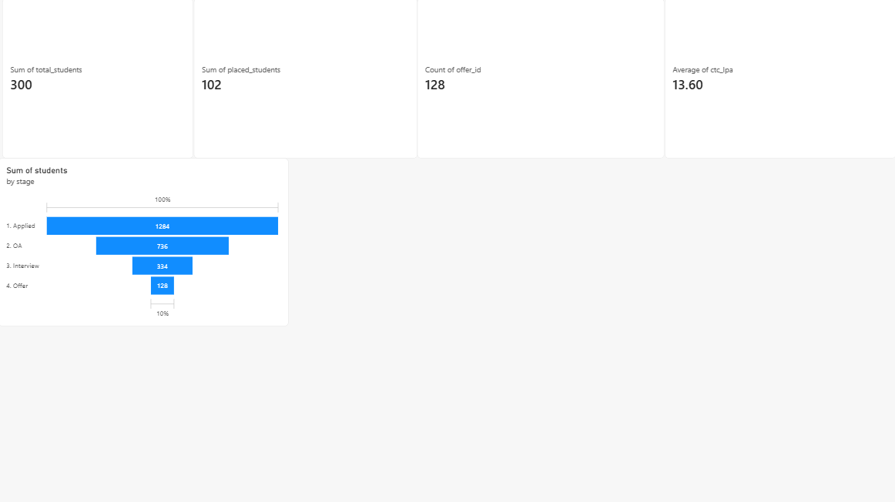
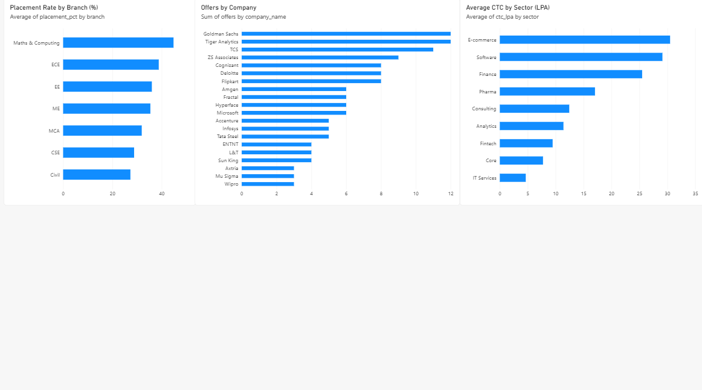

# Placement Analytics Dashboard

End-to-end analytics project for a college Training & Placement cell: SQL + Python data pipeline feeding a Power BI dashboard.

> **Note:** All data is **synthetic**, generated to mimic a T&P cell's data structure. No real student information is used. Insights shown are for demonstrating the dashboard, not real-world conclusions.

## Dashboard




## What this project covers

| Step | Tool | What was done |
|---|---|---|
| 1. Data generation | Python (pandas, NumPy) | Synthetic data for students, companies, applications and offers, with deliberately injected quality issues |
| 2. Data cleaning | Python (pandas) | Fixed 306 data quality issues |
| 3. Storage | MySQL | 4 relational tables with foreign keys |
| 4. Analysis | SQL | Joins, aggregations, window functions (`RANK() OVER`), views |
| 5. Visualisation | Power BI | KPI cards, funnel, branch / company / sector charts |

## Data quality issues fixed

- 10 duplicate student records removed
- 20 inconsistent branch labels standardised (e.g. `cse`, `Computer Sc` to `CSE`)
- 15 missing CGPA values filled using branch median
- 4 duplicate company records merged (e.g. `AMGEN`, `Tata Consultancy Services`), with foreign keys remapped
- 256 duplicate applications and 1 duplicate offer removed

## KPIs tracked

- Total students, placed students, total offers, average CTC
- Placement funnel: 1284 applied, 736 reached OA, 334 reached interview, 128 offers
- Placement rate by branch
- Offers by company and average CTC by sector

## Project structure

```
generate_data.py     # creates raw synthetic CSVs
clean_data.py        # cleans data, prints data quality report
load_to_mysql.py     # loads clean data into MySQL
export_views.py      # exports SQL views to CSV for Power BI
sql/                 # schema, views and KPI queries
placement_data/      # raw and clean CSVs
dashboard_data/      # CSVs consumed by Power BI
screenshots/         # dashboard screenshots
placement_dashboard.pbix
```

## How to run

1. Create the database and tables: run `sql/schema.sql` in MySQL.
2. `python generate_data.py`
3. `python clean_data.py`
4. Put your own MySQL credentials in `load_to_mysql.py` and `export_views.py`, then run `python load_to_mysql.py`.
5. Run `sql/views.sql` in MySQL, then `python export_views.py`.
6. Open `placement_dashboard.pbix` in Power BI Desktop.

## Tech stack

Python (pandas, NumPy, SQLAlchemy), MySQL, Power BI